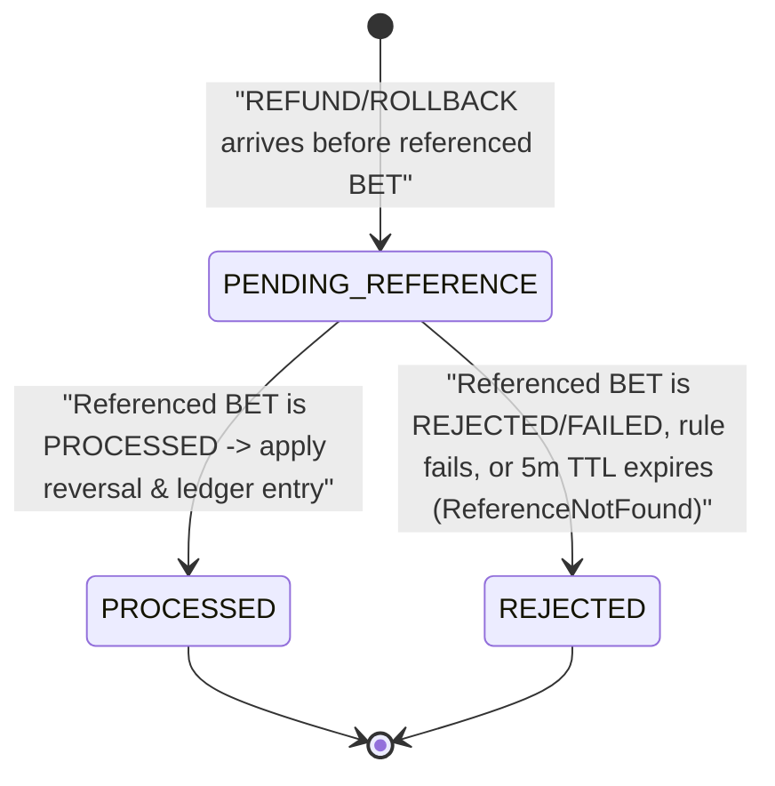

# Distributed Wagering Processor — Architecture & Design

This document details the architectural patterns, concurrency guarantees, database-level invariants, messaging topology, and observability design of the **Distributed Wagering Processor**.

---

## 1. System Architecture

The service is structured around **Domain-Driven Design (DDD)**, **Hexagonal Architecture (Ports & Adapters)**, and **Event-Driven Architecture (EDA)**, running on **Bun 1.2** with **NestJS 10** in strict TypeScript mode.


---

## 2. Concurrency Control & ORM Selection

### Why MikroORM?
**MikroORM 6.4** provides an explicit **Unit of Work** and **Identity Map** per request/transaction scope. All entity mutations inside `em.transactional(...)` are tracked and flushed atomically in a single database transaction, preventing partial side effects across `wallets`, `wager_transactions`, `wallet_ledger_entries`, and `outbox_messages`.

### Per-Wallet Pessimistic Locking (`PESSIMISTIC_WRITE`)
The unit of concurrency is `walletId`. To guarantee zero balance drift under simultaneous requests across multiple application instances:

1. Every balance-mutating transaction sets a bounded local lock timeout before acquiring the row lock:
   ```sql
   SET LOCAL lock_timeout = '5000ms';
   SELECT * FROM wallets WHERE id = $1 FOR UPDATE;
   ```
   Executed via `em.findOne(WalletOrmEntity, { id }, { lockMode: LockMode.PESSIMISTIC_WRITE })`.
2. Concurrent requests targeting the **same** `walletId` are serialized cleanly by PostgreSQL's row-level lock manager without optimistic retry storms or external Redis locks.
3. Requests targeting **different** `walletId`s execute in full parallel with zero cross-wallet contention.
4. Read-only reconciliation (`POST /wallets/:walletId/reconciliation`) uses `LockMode.PESSIMISTIC_READ` to compute SQL `SUM`/`COUNT` over `wallet_ledger_entries` against a consistent snapshot.

---

## 3. Wager Processing, Inbox & Transactional Outbox Sequence

To guarantee *at-least-once* event delivery and idempotent message processing without distributed two-phase commit (2PC):

```mermaid
sequenceDiagram
  autonumber
  participant Caller as "HTTP Client / SQS Consumer"
  participant App as "ProcessWagerTransactionUseCase"
  participant PG as "PostgreSQL 16"
  participant Outbox as "OutboxPublisherWorker"
  participant SQS as "SQS FIFO (wager-events.fifo)"

  Caller->>App: "Submit wager (Idempotency-Key + x-provider-id)"
  App->>PG: "BEGIN; SET LOCAL lock_timeout = '5000ms'"
  App->>PG: "SELECT ... FROM wallets WHERE id = $1 FOR UPDATE (PESSIMISTIC_WRITE)"
  App->>PG: "Check inbox (if SQS) & idempotency_key + canonical SHA-256 payloadHash"
  alt "Identical Replay"
    PG-->>App: "Existing transaction + persisted observed_balance"
    App-->>Caller: "200 OK (idempotentReplay: true)"
  else "Conflicting Payload"
    App-->>Caller: "409 IDEMPOTENCY_CONFLICT"
  else "New Transaction"
    App->>PG: "INSERT wager_transactions + INSERT wallet_ledger_entries"
    App->>PG: "UPDATE wallets.balance + INSERT outbox_messages"
    App->>PG: "COMMIT"
    App-->>Caller: "200 OK (or SQS DeleteMessage post-commit)"
  end

  loop "Every OUTBOX_POLL_INTERVAL_MS"
    Outbox->>PG: "Phase 1: SELECT ... FROM outbox_messages WHERE ... FOR UPDATE SKIP LOCKED (30s lease)"
    Outbox->>SQS: "Phase 2 (outside tx): SendMessage (MessageGroupId=walletId, DeduplicationId=id)"
    Outbox->>PG: "Phase 3: UPDATE outbox_messages SET published_at = NOW() (or backoff on error)"
  end
```

### Worker Mechanics (`FOR UPDATE SKIP LOCKED`)
- **`OutboxPublisherWorker` (3-Phase Pattern)**:
  1. **Claim**: Inside a short transaction, selects due unpublished rows using `LockMode.PESSIMISTIC_PARTIAL_WRITE` (`FOR UPDATE SKIP LOCKED`) and sets a 30-second lease (`next_attempt_at`) so concurrent replicas never claim the same rows.
  2. **Publish**: Sends the `IntegrationEvent` envelope to `wager-events.fifo` **outside** the database transaction, avoiding holding DB connections open during network I/O.
  3. **Acknowledge / Backoff**: Marks `published_at` on success, or increments `attempts` with exponential backoff and increments `wagering_message_retries_total` on failure.
- **Inbox Pattern (`inbox_messages`)**:
  - `SqsConsumerService` (`consumerName = "WagerSqsConsumer"`) records `(consumer_name, message_id)` in `inbox_messages` inside the same database transaction and executes `DeleteMessageCommand` only **after** the transaction commits. Poison messages exceeding `maxReceiveCount = 5` are routed by SQS to `wager-transactions-dlq.fifo`.

---

## 4. Out-of-Order `PENDING_REFERENCE` State Machine

Providers may deliver a `REFUND` or `ROLLBACK` before the referenced `BET` arrives or commits. Instead of failing immediately or blocking the HTTP/SQS thread:



`PendingReferenceWorker` polls `wager_transactions` with `status = 'PENDING_REFERENCE'` using `FOR UPDATE SKIP LOCKED` (`LockMode.PESSIMISTIC_PARTIAL_WRITE`) and resolves each entry **in-place within a single transaction**:
1. Locks the target `wallet` row first (`PESSIMISTIC_WRITE`) to preserve lock ordering and prevent deadlocks.
2. Looks up the referenced transaction:
   - If not yet present and within the 5-minute TTL, schedules the next attempt.
   - If the referenced transaction is `REJECTED` or `FAILED`, fast-rejects the pending reversal as `REJECTED`.
   - If the referenced transaction is `PROCESSED`, applies the balance reversal, writes the immutable ledger entry, and enqueues the `IntegrationEvent` to `outbox_messages`.
   - If the 5-minute TTL has elapsed, calls `rejectInPlace(...)` to transition the transaction to `REJECTED` (`FailureCode.ReferenceNotFound`).

---

## 5. PostgreSQL Structural Guarantees

Financial integrity is enforced at the schema level (`src/infrastructure/database/migrations/Migration20261015000000_InitialSchema.ts`), independent of application bugs:

1. **One Wallet per Player & Currency**:
   ```sql
   CONSTRAINT "uq_wallet_player_currency" UNIQUE ("player_id", "currency")
   ```
2. **Non-Negative Wallet Balance**:
   ```sql
   CONSTRAINT "chk_wallet_balance_non_negative" CHECK ("balance" >= 0)
   ```
3. **Ledger Entry Uniqueness & Double-Entry Math**:
   ```sql
   CONSTRAINT "uq_ledger_wallet_transaction" UNIQUE ("wallet_id", "transaction_id"),
   CONSTRAINT "chk_ledger_direction_valid" CHECK ("direction" IN ('DEBIT', 'CREDIT')),
   CONSTRAINT "chk_ledger_amounts_positive" CHECK ("amount" >= 0 AND "balance_before" >= 0 AND "balance_after" >= 0),
   CONSTRAINT "chk_ledger_math" CHECK (
     ("direction" = 'DEBIT' AND "balance_before" - "amount" = "balance_after") OR
     ("direction" = 'CREDIT' AND "balance_before" + "amount" = "balance_after")
   )
   ```
4. **Ledger Immutability Trigger**:
   ```sql
   CREATE OR REPLACE FUNCTION fn_prevent_ledger_modification()
   RETURNS TRIGGER AS $$
   BEGIN
     RAISE EXCEPTION 'Wallet ledger entries are immutable and cannot be updated or deleted.';
   END;
   $$ LANGUAGE plpgsql;

   CREATE TRIGGER trg_prevent_ledger_update_or_delete
   BEFORE UPDATE OR DELETE ON "wallet_ledger_entries"
   FOR EACH ROW
   EXECUTE FUNCTION fn_prevent_ledger_modification();
   ```
5. **Double-Reversal Prevention (Partial Unique Index)**:
   ```sql
   CREATE UNIQUE INDEX "idx_unique_reversal"
   ON "wager_transactions" ("reference_transaction_id", "kind")
   WHERE "status" = 'PROCESSED' AND "kind" IN ('REFUND', 'ROLLBACK');
   ```

---

## 6. Monetary Precision & Canonical Idempotency

### `Money` Value Object
- Backed by `decimal.js` configured with **precision 28** and **`ROUND_HALF_UP`**.
- Enforces a maximum of **2 decimal places** and rejects `NaN`, `Infinity`, empty strings, and scientific notation at construction. `Money.from()` accepts signed numeric strings (to support signed delta/arithmetic representation), while `Wallet` (`open`, `debit`, `credit`) rejects negative amounts with `InsufficientFundsError`.
- Cross-currency arithmetic throws `CurrencyMismatchError`.

### Canonical SHA-256 `payloadHash` & Faithful Replay
- `Idempotency-Key` defaults to `${providerId}:${externalTransactionId}` when omitted.
- A SHA-256 digest is computed over a recursively key-sorted canonical JSON representation of the business payload.
- **Matching key + matching hash**: Returns `200 OK` with `idempotentReplay: true` and the persisted `observed_balance` captured at the exact moment the original transaction completed—subsequent wallet activity never alters historical replays.
- **Matching key + divergent hash**: Returns `409 Conflict` (`IDEMPOTENCY_CONFLICT`).

---

## 7. Authentication & Provider Identity Extension

The HTTP layer enforces provider identity through `AuthGuard` (`src/presentation/guards/auth.guard.ts`) and controller-level checks:
- In the local/demo configuration, `AuthGuard` skips `/health`, `/metrics`, and `/docs*` routes, reads the `x-provider-id` header (defaulting to `"provider-a"`), and attaches `request.providerIdentity = { providerId, authenticated: true }`.
- `WageringController` enforces that `request.providerIdentity.providerId` matches `body.providerId` or `:providerId` (returning `403 Forbidden` on mismatch).
- In production, `AuthGuard` is designed to be backed by an external OIDC Identity Provider (e.g., **Keycloak** or **Zitadel**) using OAuth2 Client Credentials (`client_id` + `client_secret`), validating JWT signatures against cached JWKS (`/.well-known/jwks.json`) and populating `request.providerIdentity` from signed token claims.

---

## 8. Observability & Log Sanitization

- **Structured Logging (Pino)**: JSON logs include `correlationId` (propagated by `CorrelationIdMiddleware` via `X-Correlation-Id`), `transactionId`, `walletId`, and `providerId`. Sensitive credentials and full financial payloads are never logged.
- **Health Checks**:
  - `GET /health/live`: Lightweight process liveness check (`{ status: "UP", timestamp }`).
  - `GET /health/ready`: Active dependency readiness check executing `SELECT 1` on PostgreSQL and `ListQueuesCommand` on SQS (`200` or `503`).
- **Prometheus Metrics (`GET /metrics`)**:
  - `wagering_transactions_total` (`kind`, `status`, `provider_id`)
  - `wagering_duplicate_transactions_total` (`provider_id`)
  - `wagering_message_retries_total` (`worker_name`)
  - `wagering_dlq_messages_total`
  - `wagering_lock_conflicts_total`
  - `wagering_outbox_lag_messages`
  - `wagering_transaction_duration_seconds` (`kind`, `status`; buckets `[0.005, 0.01, 0.025, 0.05, 0.1, 0.25, 0.5, 1, 2.5]`)
