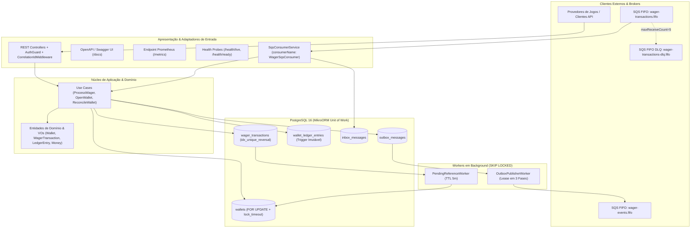
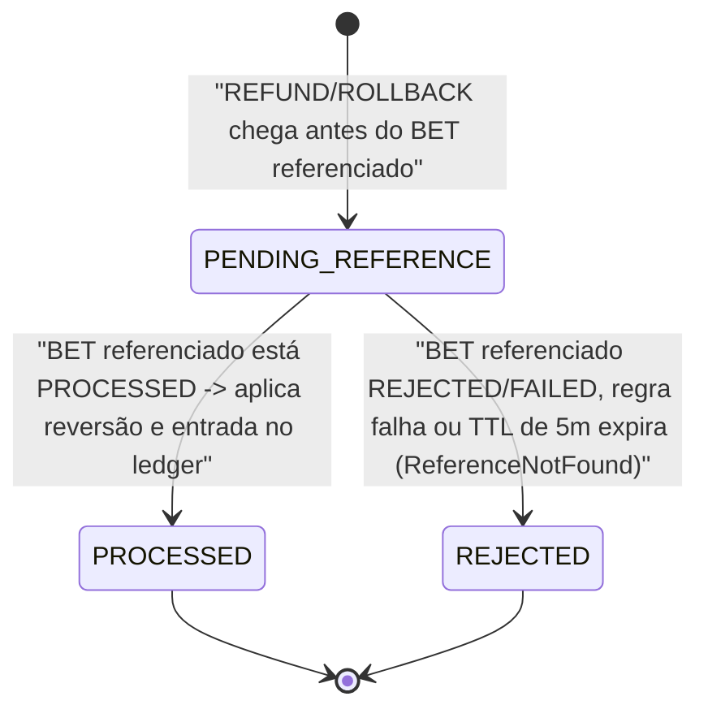

# Distributed Wagering Processor — Arquitetura & Design

Este documento detalha os padrões arquiteturais, garantias de concorrência, invariantes em nível de banco de dados, topologia de mensageria e design de observabilidade do **Distributed Wagering Processor**.

---

## 1. Arquitetura do Sistema

O serviço é estruturado em torno de **Domain-Driven Design (DDD)**, **Arquitetura Hexagonal (Ports & Adapters)** e **Arquitetura Orientada a Eventos (EDA)**, executando em **Bun 1.2** com **NestJS 10** em modo TypeScript estrito.



---

## 2. Controle de Concorrência & Escolha do ORM

### Por que MikroORM?
O **MikroORM 6.4** fornece **Unit of Work** e **Identity Map** explícitos por escopo de requisição/transação. Todas as mutações de entidades dentro de `em.transactional(...)` são rastreadas e persistidas atomicamente em uma única transação SQL, evitando efeitos colaterais parciais entre `wallets`, `wager_transactions`, `wallet_ledger_entries` e `outbox_messages`.

### Locking Pessimista por Carteira (`PESSIMISTIC_WRITE`)
A unidade de concorrência é o `walletId`. Para garantir zero divergência de saldo sob requisições simultâneas entre múltiplas instâncias da aplicação:

1. Toda transação que altera saldo define um timeout local limitado antes de adquirir o lock da linha:
   ```sql
   SET LOCAL lock_timeout = '5000ms';
   SELECT * FROM wallets WHERE id = $1 FOR UPDATE;
   ```
   Executado via `em.findOne(WalletOrmEntity, { id }, { lockMode: LockMode.PESSIMISTIC_WRITE })`.
2. Requisições concorrentes para o **mesmo** `walletId` são serializadas de forma limpa pelo gerenciador de locks de linha do PostgreSQL, sem tempestades de retries otimistas nem locks distribuídos em Redis.
3. Requisições para **`walletId`s distintos** executam em total paralelismo, sem contenção entre carteiras.
4. A reconciliação somente leitura (`POST /wallets/:walletId/reconciliation`) usa `LockMode.PESSIMISTIC_READ` para calcular `SUM`/`COUNT` SQL sobre `wallet_ledger_entries` em um snapshot consistente.

---

## 3. Processamento de Apostas, Inbox & Outbox Transacional

Para garantir entrega de eventos *at-least-once* e processamento idempotente de mensagens sem two-phase commit distribuído (2PC):

```mermaid
sequenceDiagram
  autonumber
  participant Caller as "Cliente HTTP / SQS Consumer"
  participant App as "ProcessWagerTransactionUseCase"
  participant PG as "PostgreSQL 16"
  participant Outbox as "OutboxPublisherWorker"
  participant SQS as "SQS FIFO (wager-events.fifo)"

  Caller->>App: "Submete aposta (Idempotency-Key + x-provider-id)"
  App->>PG: "BEGIN; SET LOCAL lock_timeout = '5000ms'"
  App->>PG: "SELECT ... FROM wallets WHERE id = $1 FOR UPDATE (PESSIMISTIC_WRITE)"
  App->>PG: "Verifica inbox (se SQS) & idempotency_key + payloadHash SHA-256 canônico"
  alt "Replay Idêntico"
    PG-->>App: "Transação existente + observed_balance persistido"
    App-->>Caller: "200 OK (idempotentReplay: true)"
  else "Payload Divergente"
    App-->>Caller: "409 IDEMPOTENCY_CONFLICT"
  else "Nova Transação"
    App->>PG: "INSERT wager_transactions + INSERT wallet_ledger_entries"
    App->>PG: "UPDATE wallets.balance + INSERT outbox_messages"
    App->>PG: "COMMIT"
    App-->>Caller: "200 OK (ou SQS DeleteMessage pós-commit)"
  end

  loop "A cada OUTBOX_POLL_INTERVAL_MS"
    Outbox->>PG: "Fase 1: SELECT ... FROM outbox_messages WHERE ... FOR UPDATE SKIP LOCKED (lease 30s)"
    Outbox->>SQS: "Fase 2 (fora da tx): SendMessage (MessageGroupId=walletId, DeduplicationId=id)"
    Outbox->>PG: "Fase 3: UPDATE outbox_messages SET published_at = NOW() (ou backoff em erro)"
  end
```

### Mecânica dos Workers (`FOR UPDATE SKIP LOCKED`)
- **`OutboxPublisherWorker` (Padrão em 3 Fases)**:
  1. **Claim**: Dentro de uma transação curta, seleciona linhas pendentes vencidas usando `LockMode.PESSIMISTIC_PARTIAL_WRITE` (`FOR UPDATE SKIP LOCKED`) e define um lease de 30 segundos (`next_attempt_at`) para que réplicas concorrentes nunca capturem as mesmas linhas.
  2. **Publish**: Envia o envelope `IntegrationEvent` para `wager-events.fifo` **fora** da transação de banco, evitando manter conexões abertas durante I/O de rede.
  3. **Acknowledge / Backoff**: Marca `published_at` em caso de sucesso, ou incrementa `attempts` com backoff exponencial e incrementa `wagering_message_retries_total` em caso de falha.
- **Padrão Inbox (`inbox_messages`)**:
  - O `SqsConsumerService` (`consumerName = "WagerSqsConsumer"`) registra `(consumer_name, message_id)` em `inbox_messages` dentro da mesma transação de banco e executa `DeleteMessageCommand` somente **após** o commit da transação. Mensagens inválidas/venenosas que excedem `maxReceiveCount = 5` são encaminhadas pelo SQS para `wager-transactions-dlq.fifo`.

---

## 4. Máquina de Estados `PENDING_REFERENCE` (Fora de Ordem)

Provedores podem entregar um `REFUND` ou `ROLLBACK` antes que o `BET` referenciado chegue ou conclua o commit. Em vez de falhar imediatamente ou bloquear a thread HTTP/SQS:



O `PendingReferenceWorker` consulta `wager_transactions` com `status = 'PENDING_REFERENCE'` usando `FOR UPDATE SKIP LOCKED` (`LockMode.PESSIMISTIC_PARTIAL_WRITE`) e resolve cada entrada **in-place dentro de uma única transação**:
1. Adquire o lock da linha de `wallet` primeiro (`PESSIMISTIC_WRITE`) para preservar a ordem de locks e evitar deadlocks.
2. Consulta a transação referenciada:
   - Se ainda não existir e estiver dentro do TTL de 5 minutos, agenda a próxima tentativa.
   - Se a transação referenciada estiver `REJECTED` ou `FAILED`, rejeita rapidamente a reversão pendente como `REJECTED`.
   - Se a transação referenciada estiver `PROCESSED`, aplica a reversão de saldo, grava a entrada imutável no ledger e enfileira o `IntegrationEvent` em `outbox_messages`.
   - Se o TTL de 5 minutos tiver expirado, chama `rejectInPlace(...)` para transicionar a transação para `REJECTED` (`FailureCode.ReferenceNotFound`).

---

## 5. Garantias Estruturais no PostgreSQL

A integridade financeira é garantida diretamente no schema (`src/infrastructure/database/migrations/Migration20261015000000_InitialSchema.ts`), independente de bugs na aplicação:

1. **Uma Carteira por Jogador e Moeda**:
   ```sql
   CONSTRAINT "uq_wallet_player_currency" UNIQUE ("player_id", "currency")
   ```
2. **Saldo de Carteira Não Negativo**:
   ```sql
   CONSTRAINT "chk_wallet_balance_non_negative" CHECK ("balance" >= 0)
   ```
3. **Unicidade do Ledger & Matemática de Partida Dobrada**:
   ```sql
   CONSTRAINT "uq_ledger_wallet_transaction" UNIQUE ("wallet_id", "transaction_id"),
   CONSTRAINT "chk_ledger_direction_valid" CHECK ("direction" IN ('DEBIT', 'CREDIT')),
   CONSTRAINT "chk_ledger_amounts_positive" CHECK ("amount" >= 0 AND "balance_before" >= 0 AND "balance_after" >= 0),
   CONSTRAINT "chk_ledger_math" CHECK (
     ("direction" = 'DEBIT' AND "balance_before" - "amount" = "balance_after") OR
     ("direction" = 'CREDIT' AND "balance_before" + "amount" = "balance_after")
   )
   ```
4. **Trigger de Imutabilidade do Ledger**:
   ```sql
   CREATE OR REPLACE FUNCTION fn_prevent_ledger_modification()
   RETURNS TRIGGER AS $$
   BEGIN
     RAISE EXCEPTION 'Wallet ledger entries are immutable and cannot be updated or deleted.';
   END;
   $$ LANGUAGE plpgsql;

   CREATE TRIGGER trg_prevent_ledger_update_or_delete
   BEFORE UPDATE OR DELETE ON "wallet_ledger_entries"
   FOR EACH ROW
   EXECUTE FUNCTION fn_prevent_ledger_modification();
   ```
5. **Prevenção de Dupla Reversão (Índice Único Parcial)**:
   ```sql
   CREATE UNIQUE INDEX "idx_unique_reversal"
   ON "wager_transactions" ("reference_transaction_id", "kind")
   WHERE "status" = 'PROCESSED' AND "kind" IN ('REFUND', 'ROLLBACK');
   ```

---

## 6. Precisão Monetária & Idempotência Canônica

### Value Object `Money`
- Baseado em `decimal.js` configurado com **precisão 28** e **`ROUND_HALF_UP`**.
- Impõe no máximo **2 casas decimais** e rejeita `NaN`, `Infinity`, strings vazias e notação científica na construção. `Money.from()` aceita strings numéricas com sinal (para suportar representação de delta/aritmética), enquanto `Wallet` (`open`, `debit`, `credit`) rejeita valores negativos com `InsufficientFundsError`.
- Operações entre moedas diferentes lançam `CurrencyMismatchError`.

### `payloadHash` SHA-256 Canônico & Replay Fiel
- `Idempotency-Key` assume `${providerId}:${externalTransactionId}` por padrão quando omitido.
- Um digest SHA-256 é calculado sobre a representação JSON canônica (chaves ordenadas recursivamente) do payload de negócio.
- **Mesma chave + mesmo hash**: Retorna `200 OK` com `idempotentReplay: true` e o `observed_balance` persistido no exato momento em que a transação original foi concluída — movimentações posteriores na carteira nunca alteram replays históricos.
- **Mesma chave + hash divergente**: Retorna `409 Conflict` (`IDEMPOTENCY_CONFLICT`).

---

## 7. Autenticação & Extensão de Identidade do Provedor

A camada HTTP aplica validação de identidade do provedor via `AuthGuard` (`src/presentation/guards/auth.guard.ts`) e checagens nos controllers:
- Na configuração local/demo, o `AuthGuard` ignora as rotas `/health`, `/metrics` e `/docs*`, lê o header `x-provider-id` (padrão `"provider-a"`) e anexa `request.providerIdentity = { providerId, authenticated: true }`.
- O `WageringController` garante que `request.providerIdentity.providerId` corresponda a `body.providerId` ou `:providerId` (retornando `403 Forbidden` em caso de divergência).
- Em produção, o `AuthGuard` foi projetado para integrar com um Identity Provider OIDC externo (ex.: **Keycloak** ou **Zitadel**) usando OAuth2 Client Credentials (`client_id` + `client_secret`), validando assinaturas JWT contra JWKS em cache (`/.well-known/jwks.json`) e preenchendo `request.providerIdentity` a partir das claims assinadas do token.

---

## 8. Observabilidade & Sanitização de Logs

- **Logs Estruturados (Pino)**: Logs em JSON incluem `correlationId` (propagado pelo `CorrelationIdMiddleware` via `X-Correlation-Id`), `transactionId`, `walletId` e `providerId`. Credenciais sensíveis e payloads financeiros completos nunca são logados.
- **Health Checks**:
  - `GET /health/live`: Probe leve de liveness do processo (`{ status: "UP", timestamp }`).
  - `GET /health/ready`: Probe ativo de readiness executando `SELECT 1` no PostgreSQL e `ListQueuesCommand` no SQS (`200` ou `503`).
- **Métricas Prometheus (`GET /metrics`)**:
  - `wagering_transactions_total` (`kind`, `status`, `provider_id`)
  - `wagering_duplicate_transactions_total` (`provider_id`)
  - `wagering_message_retries_total` (`worker_name`)
  - `wagering_dlq_messages_total`
  - `wagering_lock_conflicts_total`
  - `wagering_outbox_lag_messages`
  - `wagering_transaction_duration_seconds` (`kind`, `status`; buckets `[0.005, 0.01, 0.025, 0.05, 0.1, 0.25, 0.5, 1, 2.5]`)
